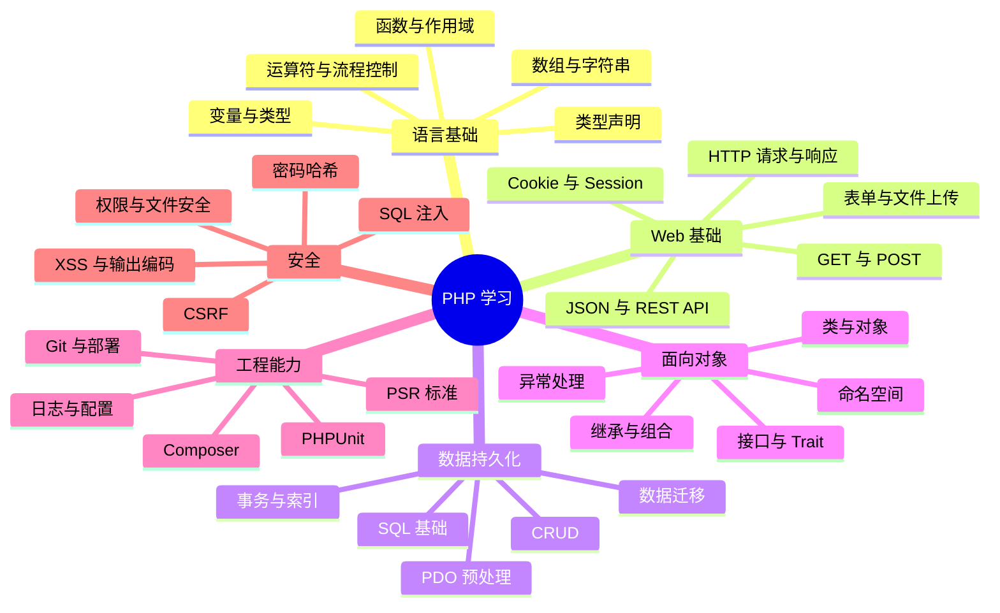

# PHP 学习手册

> 本页是整个仓库的知识导航。学习目标不是背语法，而是能够解释运行机制、写出可维护的代码，并独立完成一个安全的 Web 应用。

## 一、知识地图



## 二、章节导航

| 阶段 | 核心内容 | 完成标准 |
| --- | --- | --- |
| 00 环境 | PHP CLI、配置文件、扩展、内置服务器 | 能解释 CLI 与 Web SAPI 的区别 |
| 01 语法 | 变量、常量、类型、运算符、流程控制 | 能独立完成基础算法练习 |
| 02 数据处理 | 数组、字符串、日期、正则、JSON | 能处理常见业务数据 |
| 03 函数 | 参数、返回值、作用域、闭包、类型声明 | 能拆分可复用函数并处理边界值 |
| 04 Web | HTTP、表单、Cookie、Session、上传 | 能实现带校验的表单流程 |
| 05 数据库 | SQL、PDO、预处理、事务、分页 | 能完成安全 CRUD 并理解事务边界 |
| 06 OOP | 类、接口、组合、异常、命名空间 | 能把业务逻辑组织成清晰的类 |
| 07 工程化 | Composer、PSR、环境配置、日志 | 能管理依赖并分离配置与代码 |
| 08 安全测试 | XSS、CSRF、密码、授权、单元测试 | 能列出威胁并为关键逻辑编写测试 |
| 09 API | 路由、状态码、JSON、分页、错误格式 | 能设计一致的 REST API |
| 10 项目 | 笔记管理、标签、搜索、导入导出 | 能从需求、数据模型做到部署和复盘 |

## 三、推荐目录约定

新练习可以逐步按主题建立目录；无需一次性重排现有的 `PHPBasic/PHP01~PHP04`。

```text
PHP/
├── README.md
├── PHPBasic/                 # 现有基础代码，逐步补充说明
├── Doc/
│   ├── PHPGuide.md           # 本导航
│   └── PHP学习路线.md
├── Examples/
│   ├── language/
│   ├── functions/
│   ├── web/
│   ├── database/
│   └── oop/
├── Projects/
│   └── notes-app/            # 后续实战项目
├── MindManager/
└── Image/
```

## 四、每章的学习闭环

1. 阅读官方手册中对应章节。
2. 用最小示例验证语法和输出。
3. 主动测试空值、错误类型、非法输入和异常情况。
4. 写 3～5 道自测题，不看笔记尝试回答。
5. 把相关知识链接起来，例如“表单输入 → 校验 → PDO 预处理 → 输出编码”。
6. 将可复用的实现整理为独立示例，并记录 PHP 版本要求。

## 五、重要工程约定

- 使用 `declare(strict_types=1);` 时，要理解它的作用范围与限制，而不是认为它会自动验证所有数据。
- 用户输入永远不能直接拼接进 SQL；使用 PDO 参数绑定。
- HTML 输出根据上下文编码；常见文本场景可使用 `htmlspecialchars($value, ENT_QUOTES | ENT_SUBSTITUTE, 'UTF-8')`。
- 密码使用 `password_hash()` 和 `password_verify()`，不要自行设计哈希算法。
- 上传文件需检查大小、错误码、真实文件类型与存储位置；不要信任原始文件名或扩展名。
- 配置、密钥和生产数据不应提交到 Git。
- 开发服务器仅用于本地调试；上线需使用合适的 Web 服务器、PHP-FPM 或平台方案，并配置 HTTPS、日志与备份。

## 六、项目实践路线

| 项目 | 主要练习点 | 扩展方向 |
| --- | --- | --- |
| 命令行通讯录 | 数组、函数、文件读写 | JSON 持久化、搜索与排序 |
| 文章管理 CRUD | HTTP、PDO、表单校验 | 分页、排序、事务 |
| 登录与权限模块 | Session、密码哈希、授权 | CSRF、登录限流、审计日志 |
| JSON API | 路由、状态码、异常处理 | Token、分页、API 文档 |
| 个人笔记系统 | Markdown、标签、搜索、数据库 | 导入导出、备份、静态发布 |

## 七、阶段复盘模板

每个阶段完成后回答：

- 我现在可以独立实现什么？
- 哪个概念我能使用但还解释不清？
- 我测试了哪些边界情况？
- 代码中有哪些安全风险？
- 如果需求扩大一倍，当前结构会在哪里变得难以维护？
- 下一步要把哪项知识用于真实项目？

## 八、官方资料

- [PHP 官方手册（中文）](https://www.php.net/manual/zh/)
- [PHP 语言参考](https://www.php.net/manual/zh/langref.php)
- [PDO 文档](https://www.php.net/manual/zh/book.pdo.php)
- [Composer 文档](https://getcomposer.org/doc/)
- [PHP-FIG PSR 标准](https://www.php-fig.org/psr/)
