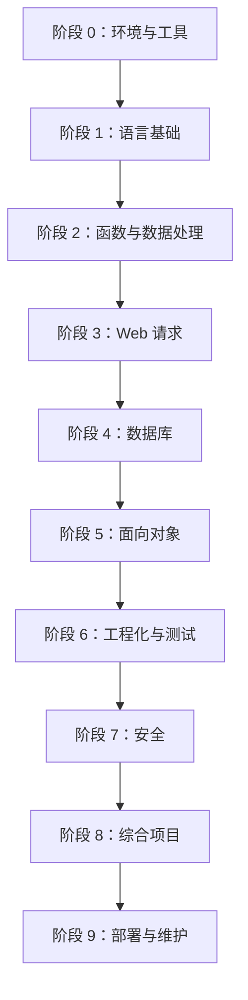

# PHP 个人学习路线

这份路线面向“能写代码、能解决实际问题、能维护项目”的目标。可按每周 4～6 小时推进；具体时长按自己的基础调整，不必为了赶进度跳过练习。

## 总览

## 阶段 0：环境与工具

**学习内容**
- 安装并检查 PHP CLI，了解 `php.ini`、扩展和错误报告。
- 理解 CLI 与 Web SAPI 的差异。
- 使用 Git 管理学习记录，了解 Composer 的用途。

**练习**
- 编写 `hello.php`，输出 PHP 版本、当前时间和数组。
- 使用 `php -l hello.php` 检查语法。
- 记录本地 PHP 版本与已启用扩展。

**验收**：可以从命令行运行脚本，定位常见语法错误。

## 阶段 1：语言基础

**学习内容**
- 变量、常量、标量类型、类型转换、比较与逻辑运算。
- `if`、`switch`、`match`、循环、`break` 与 `continue`。
- 空值处理、严格比较、真假值转换。

**练习**
- 温度单位转换、成绩分级、闰年判断。
- 数组中最大值、平均值、去重与排序。
- 为每个例子补充边界输入。

**验收**：能解释 `==` 与 `===` 的差异，避免依赖隐式类型转换。

## 阶段 2：函数与数据处理

**学习内容**
- 函数、参数默认值、返回类型、可变参数、匿名函数与闭包。
- 索引数组、关联数组、数组常用函数。
- 字符串、正则、日期时间、JSON、文件读写。

**练习**
- 将重复逻辑抽成函数。
- 读取 JSON 文件并统计数据。
- 编写输入校验函数，并区分“格式正确”与“业务上允许”。

**验收**：函数职责单一，有明确输入、输出和错误处理方式。

## 阶段 3：Web 与 HTTP

**学习内容**
- 请求、响应、方法、状态码、请求头与响应头。
- GET/POST、表单校验、重定向。
- Cookie、Session、文件上传与下载。
- HTML 转义与 JSON 响应。

**练习**
- 实现带服务端校验的联系表单。
- 实现 Session 计数器与安全退出。
- 处理上传失败、超限和不允许的文件类型。

**验收**：理解客户端校验不能替代服务端校验，知道 Session 不等于授权。

## 阶段 4：SQL 与 PDO

**学习内容**
- 表设计、主键、唯一约束、索引与关联。
- PDO 连接、预处理语句、参数绑定。
- CRUD、分页、事务、异常处理。
- 数据库连接配置与迁移的基本概念。

**练习**
- 实现文章列表、详情、新增、修改和删除。
- 用预处理语句完成搜索。
- 在一个业务操作中使用事务，并模拟失败回滚。

**验收**：所有用户输入均通过参数绑定进入 SQL；能解释事务何时提交或回滚。

## 阶段 5：面向对象

**学习内容**
- 类、对象、构造方法、可见性、静态成员。
- 继承与组合、接口、Trait、抽象类。
- 命名空间、自动加载、异常与类型声明。
- 依赖注入与职责分离的基本思想。

**练习**
- 把文章管理逻辑拆分为 Repository、Service 和入口层。
- 用接口隔离存储实现。
- 对非法状态抛出明确异常，并在边界处处理。

**验收**：能够说明为什么选择组合而不是层层继承。

## 阶段 6：工程化与测试

**学习内容**
- Composer 的依赖管理与自动加载。
- PSR-4、PSR-12 等常用标准。
- PHPUnit 基础、单元测试与集成测试。
- 环境配置、日志、错误处理与 Git 工作流。

**练习**
- 为核心业务逻辑添加测试。
- 把配置移出业务代码，并提供安全的示例配置文件。
- 为错误记录上下文，但不把密码、Token 等敏感信息写入日志。

**验收**：核心逻辑可自动测试，项目在新环境中能按文档启动。

## 阶段 7：Web 安全

**必须掌握**
- SQL 注入：PDO 预处理。
- XSS：按输出上下文编码。
- CSRF：使用随机 Token 并在服务端验证。
- 密码：`password_hash()` / `password_verify()`。
- 授权：每个敏感操作都在服务端检查权限。
- 文件上传：检查大小、错误码、真实类型，文件存储在不可直接执行的位置。
- 会话：登录后更新 Session ID，配置合理的 Cookie 属性。
- 错误处理：生产环境不向用户暴露堆栈和内部配置。

**练习**：对前面实现的文章管理项目进行一次安全审查，逐项记录风险、复现方式和修复措施。

**验收**：能说明每项防护针对的威胁及其局限。

## 阶段 8：综合项目——个人笔记系统

按迭代开发，不要一开始就追求完整功能。

1. **MVP**：笔记新增、列表、详情、编辑、删除。
2. **数据组织**：标签、搜索、分页、创建与更新时间。
3. **可靠性**：表单校验、异常处理、日志、备份。
4. **安全性**：登录、授权、CSRF 防护、输出编码、预处理语句。
5. **知识管理**：Markdown 内容、双向链接、关联笔记。
6. **数据迁移**：JSON/Markdown 导入导出。
7. **发布能力**：生成静态页面，区分公开内容与私密内容。

**验收**：提供数据库结构、启动步骤、功能清单、测试记录和已知限制。

## 阶段 9：部署与维护

- 了解 Nginx/Apache 与 PHP-FPM 的职责。
- 区分开发、测试和生产配置。
- 配置 HTTPS、日志轮转、数据库备份与恢复演练。
- 使用依赖锁定文件，谨慎升级依赖。
- 记录版本、部署步骤、回滚方式和故障排查流程。

## 每周复盘模板

复制到每周学习记录中：

- 本周主题：
- 新写的代码：
- 已理解的概念：
- 尚不理解的问题：
- 测试过的边界情况：
- 遇到的错误及原因：
- 本周形成的可复用笔记：
- 下周最重要的一项练习：

## 自测清单

- [ ] 能解释 PHP 的基本运行方式与请求生命周期。
- [ ] 能正确使用数组、函数、类型声明和异常。
- [ ] 能处理 HTTP 表单、Session 与 JSON。
- [ ] 能使用 PDO 预处理语句实现 CRUD。
- [ ] 能用面向对象方式组织业务代码。
- [ ] 能使用 Composer 管理依赖并编写测试。
- [ ] 能识别并缓解常见 Web 安全风险。
- [ ] 能独立完成、部署并维护一个小型项目。
