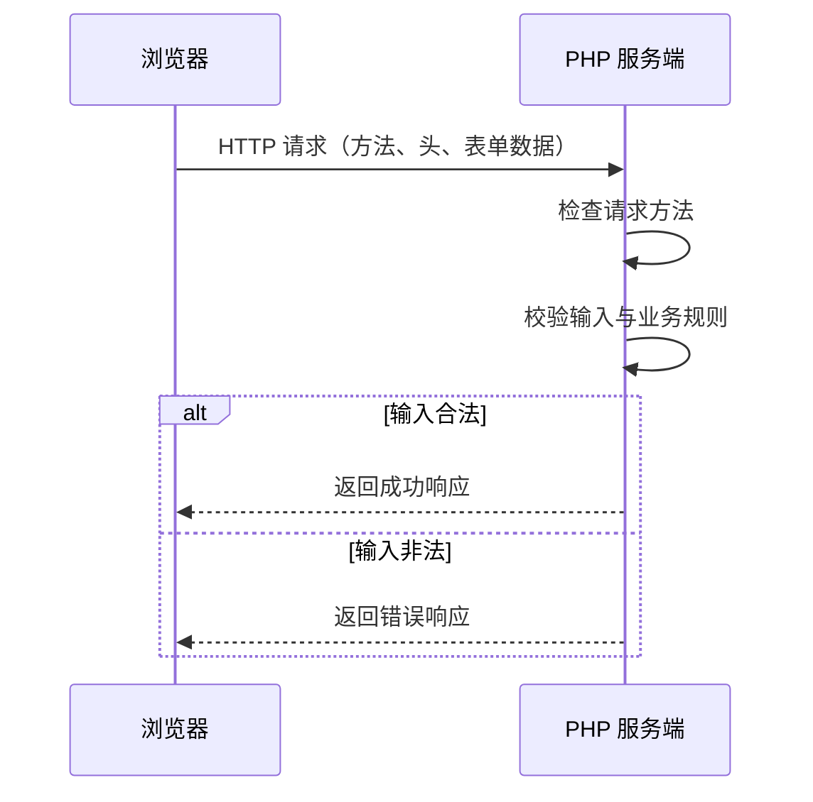

# 06｜HTTP、表单与输入校验

## 学习目标

理解浏览器表单如何提交数据，掌握 GET/POST 的区别、服务端校验与安全输出的基本做法。

## 1. 请求处理流程



浏览器端的 `required`、`maxlength` 等属性可以改善用户体验，但用户可以绕过浏览器直接构造请求。因此，服务端必须重新校验所有输入。

## 2. GET 与 POST

- GET 通常用于读取资源，参数可能出现在 URL、浏览器历史记录或日志中。
- POST 常用于提交数据，但并不意味着数据自动加密；HTTPS 才能保护传输过程。
- 不能仅凭请求方法判断用户是否有权限执行操作。
- 对会改变状态的请求，还需要考虑 CSRF 防护。

## 3. 最小 HTML 表单

```html
<form action="handle.php" method="post">
  <label>
    姓名
    <input type="text" name="name" maxlength="80" required>
  </label>
  <button type="submit">提交</button>
</form>
```

## 4. 服务端校验示例

```php
<?php
declare(strict_types=1);

header('Content-Type: text/html; charset=UTF-8');

if ($_SERVER['REQUEST_METHOD'] !== 'POST') {
    http_response_code(405);
    header('Allow: POST');
    echo 'Method Not Allowed';
    exit;
}

$name = $_POST['name'] ?? null;

if (!is_string($name)) {
    http_response_code(400);
    echo '姓名格式无效';
    exit;
}

$name = trim($name);

if ($name === '' || mb_strlen($name, 'UTF-8') > 80) {
    http_response_code(422);
    echo '姓名不能为空，且不能超过 80 个字符';
    exit;
}

$safeName = htmlspecialchars(
    $name,
    ENT_QUOTES | ENT_SUBSTITUTE,
    'UTF-8'
);

echo '提交成功，', $safeName;
```

该示例使用 `mb_strlen()`，需要启用 mbstring 扩展。实际项目还应处理 CSRF、授权、日志和统一错误页面等问题。

## 5. 校验、转义与授权不是一回事

| 机制 | 解决的问题 |
| --- | --- |
| 输入校验 | 数据是否符合预期格式与业务规则 |
| 输出编码 | 数据进入 HTML 等上下文时避免被解释为代码 |
| 身份认证 | 当前请求者是谁 |
| 权限检查 | 当前请求者能否执行这个操作 |
| CSRF Token | 降低用户浏览器被诱导发起伪造状态变更请求的风险 |

这些机制不能相互替代。

## 6. 常见错误

- 只做前端校验，不做服务端校验。
- 直接信任 `$_POST['name']` 一定是字符串。
- 将原始输入直接拼入 HTML。
- 认为 POST 请求天然安全。
- 认为隐藏按钮或隐藏字段就能保护权限。
- 对修改数据的请求忽略 CSRF 风险。

## 练习

1. 为现有 `PHP03/feedback.html` 与 `handle_form.php` 增加服务端校验。
2. 对空字符串、超长字符串、数组类型输入分别测试。
3. 为非法请求设置合适的 HTTP 状态码。
4. 在页面中显示用户输入，验证 HTML 转义是否生效。
5. 研究 Session 登录状态、权限检查和 CSRF Token 的区别。

## 自测

- 为什么服务端必须重复验证前端已验证的数据？
- POST 是否等于加密传输？
- 输入校验与 HTML 转义分别防御什么问题？
