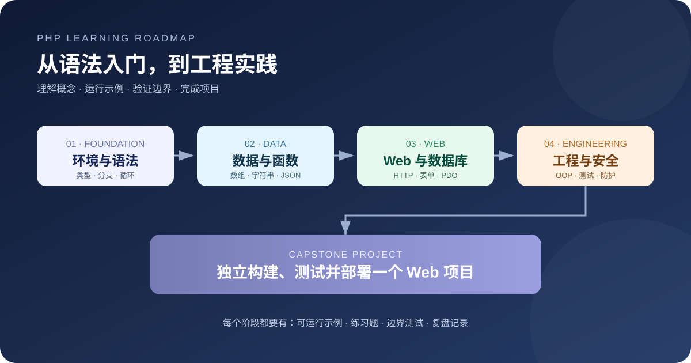
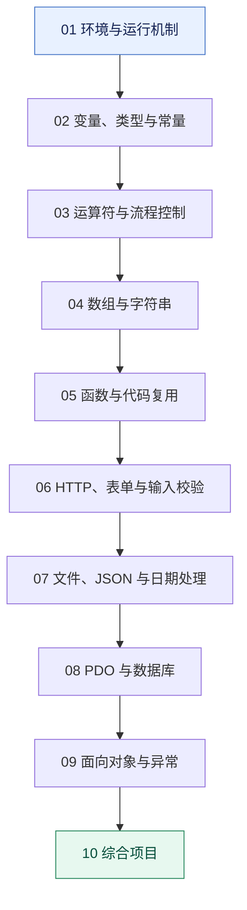
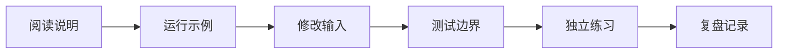

# PHP 基础学习指南

> 面向零基础学习者的逐步课程。建议按顺序阅读，不要只复制代码：先理解概念，再运行示例，最后通过练习验证自己是否真正掌握。

## 学习顺序





## 课程目录

| 顺序 | 课程 | 学完后应该能够 |
| --- | --- | --- |
| 01 | [环境与运行机制](./01-环境与运行机制.md) | 检查 PHP 版本、运行脚本并定位语法错误 |
| 02 | [变量、类型与常量](./02-变量类型与常量.md) | 选择合适的数据类型，理解类型转换 |
| 03 | [运算符与流程控制](./03-运算符与流程控制.md) | 用条件和循环表达常见业务规则 |
| 04 | [数组与字符串](./04-数组与字符串.md) | 组织列表数据并完成常见文本处理 |
| 05 | [函数与代码复用](./05-函数与代码复用.md) | 把重复逻辑拆分成职责清晰的函数 |
| 06 | [HTTP、表单与输入校验](./06-HTTP表单与输入校验.md) | 理解请求数据，并在服务端校验输入 |

后续课程将逐步扩展到文件处理、数据库、面向对象、测试与项目实践。实际代码专题见 [PHPBasic 目录](../)。

## 每节课的学习流程



建议每次学习至少完成以下任务：

- [ ] 能用自己的话解释本节核心概念。
- [ ] 能在本地独立运行示例。
- [ ] 至少修改一次输入或代码，观察结果变化。
- [ ] 测试一个边界情况和一个错误情况。
- [ ] 不看答案独立完成练习。
- [ ] 记录一个仍然不理解的问题。

## 运行环境

建议使用受支持的 PHP 8.x 版本。运行脚本：

```bash
php -v
php -l path/to/example.php
php path/to/example.php
```

Web 示例应在对应示例目录启动本地开发服务器。启动前确认目录中的入口文件和项目说明；PHP 内置服务器仅用于本地开发。

## 初学者常见误区

1. **只记语法，不理解输入和输出。** 每段示例都要自己运行，并尝试预测结果。
2. **只测试正常输入。** 额外测试空字符串、缺失字段、非法类型和极端值。
3. **认为前端校验足够。** 所有关键校验都必须在服务端执行。
4. **把输入校验当作输出安全。** 数据输出到 HTML 时仍然需要正确编码。
5. **把示例当成生产代码。** 教学代码用于解释概念，部署前还需补齐配置、授权、日志、测试和安全措施。

## 课程内容质量约定

新增课程尽量统一为以下结构：

1. 学习目标与实际问题
2. 核心概念与简明解释
3. 语法或流程图
4. 可直接运行的最小示例
5. 预期输出与逐步解析
6. 常见错误与边界情况
7. 动手练习（从基础到提高）
8. 自测题与参考答案
9. 关联课程与官方资料

官方参考：[PHP 中文手册](https://www.php.net/manual/zh/)。
