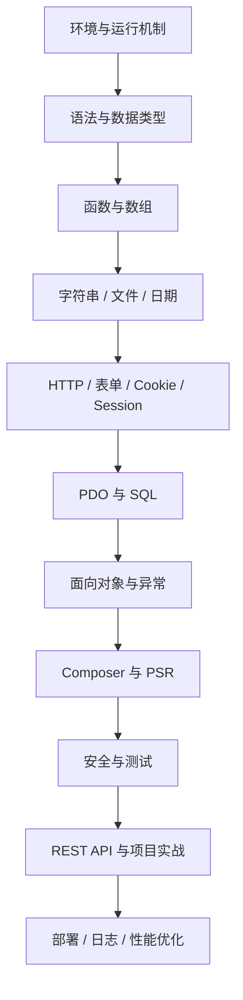

# PHP 个人学习仓库

> 从 PHP 语言基础到 Web 开发、数据库、安全、工程化与项目实战的个人学习记录。以“可运行代码 + 原理解释 + 常见错误 + 复盘问题”为主线，持续积累。

## 学习目标

- 掌握现代 PHP 语法与面向对象编程，理解 PHP 8.x 的常用特性。
- 能独立完成表单处理、会话管理、数据库 CRUD、文件上传与 REST API。
- 建立安全意识：输入校验、输出编码、SQL 注入防护、CSRF/XSS 防护、密码安全。
- 掌握 Composer、PSR、自动化测试、Git 与基础部署流程。
- 通过一个可持续迭代的个人笔记/知识库项目，把知识转化为工程能力。

## 仓库导航

| 路径 | 内容 |
| --- | --- |
| [PHPBasic](./PHPBasic/) | 原有 PHP 基础学习代码，按章节查看并逐步补充练习 |
| [Doc/PHPGuide.md](./Doc/PHPGuide.md) | 学习总导航、知识地图与阶段目标 |
| [Doc/PHP学习路线.md](./Doc/PHP学习路线.md) | 分阶段学习计划、项目路线、验收标准 |
| [MindManager](./MindManager/) | PHP 基础教程思维导图 |
| [Image](./Image/) | 学习配图与相关素材 |

## 建议学习顺序



## 每个知识点的记录模板

建议在对应章节中按以下结构整理，避免只收藏代码却没有形成可迁移的理解：

1. **问题 / 目标**：这一节要解决什么问题？
2. **核心概念**：用自己的话解释关键机制。
3. **最小示例**：提供能独立运行的代码。
4. **运行结果**：记录输出、请求响应或数据库变化。
5. **边界与陷阱**：类型转换、空值、异常、权限、安全风险。
6. **工程实践**：真实项目中如何组织和复用。
7. **复盘问题**：至少 3 道自测题，并写出答案。
8. **关联知识**：链接到相关章节，形成知识网络。

## 开发环境建议

- PHP：优先使用仍受支持的 PHP 8.x 版本，并在项目中明确最低版本。
- 编辑器：VS Code 或 PhpStorm。
- 依赖管理：Composer。
- 数据库：先掌握 SQLite 或 MySQL，再学习事务与索引。
- 本地调试：PHP 内置开发服务器仅用于本地开发，不作为生产部署方案。

检查环境：

```bash
php -v
php -m
composer --version
```

运行一个本地示例：

```bash
php -S 127.0.0.1:8000 -t public
```

然后访问 `http://127.0.0.1:8000`。只有在目录中确实存在 `public/index.php` 时才使用上面的命令；学习小脚本也可以直接执行 `php example.php`。

## 练习原则

- 每学一个概念，至少写一个最小示例和一个边界测试。
- 不把密码、Token、数据库凭据提交到仓库。
- 数据库访问优先使用 PDO 预处理语句。
- 输出到 HTML 时进行上下文正确的转义；不要把输入校验当成输出编码的替代品。
- 学习新语法时注明 PHP 最低版本，避免代码在旧环境中无法运行。
- 每完成一个阶段，提交一次 Git 记录，并在阶段复盘中写下“已掌握 / 不确定 / 待实践”。

## 阶段进度

- [ ] 阶段 0：环境与运行机制
- [ ] 阶段 1：语言基础
- [ ] 阶段 2：函数、数组与常用标准库
- [ ] 阶段 3：HTTP 与 Web 基础
- [ ] 阶段 4：数据库与事务
- [ ] 阶段 5：面向对象与代码组织
- [ ] 阶段 6：安全、测试与工程化
- [ ] 阶段 7：API 与完整项目
- [ ] 阶段 8：部署、维护与优化

## 学习资源

- [PHP 官方手册](https://www.php.net/manual/zh/)
- [PHP: The Right Way](https://phptherightway.com/)
- [Composer 官方文档](https://getcomposer.org/doc/)
- [PHP-FIG / PSR 标准](https://www.php-fig.org/psr/)

> 本仓库是持续更新的个人学习记录。遇到版本差异时，以官方手册和项目实际运行结果为准。
