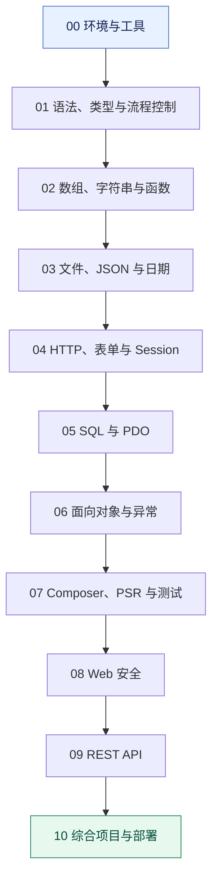
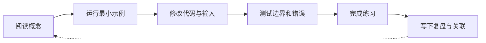
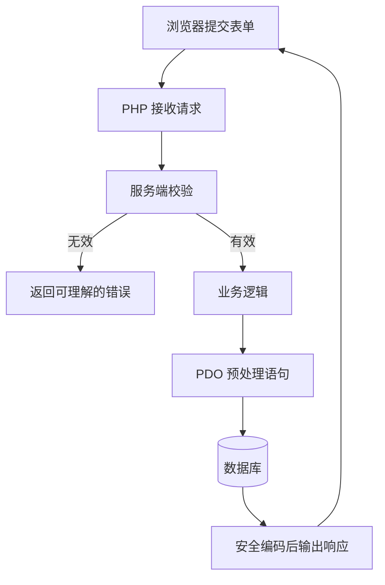

<!--
  PHP 学习仓库
  目标：让初学者能够循序渐进地从语法走向可维护、安全的 Web 项目。
-->

<div align="center">

# PHP 学习与工程实践

**从第一行代码，到安全、可测试、可维护的 Web 应用**

<p>
  
  
  
  
</p>

<p>
  <a href="https://www.php.net/manual/zh/">官方手册</a> ·
  <a href="./Doc/PHPGuide.md">知识地图</a> ·
  <a href="./Doc/PHP学习路线.md">学习路线</a> ·
  <a href="./PHPBasic/">基础示例</a>
</p>

</div>

---

## 项目简介

本仓库是一套持续迭代的 PHP 中文学习资料，面向初学者和希望补齐工程实践能力的开发者。内容遵循 **概念解释 → 最小示例 → 动手练习 → 边界测试 → 项目实践** 的学习闭环。

这里不仅记录语法，也关注代码为什么这样运行、怎样排查错误，以及如何避免常见的 Web 安全问题。学习时建议先运行代码，再阅读说明并主动修改示例。

## 可视化学习路线


这张路线图用于快速建立整体认识；详细章节、练习与验收标准请继续阅读下方的 Mermaid 学习路径和[学习路线文档](./Doc/PHP学习路线.md)。

## 学习路径一览



<details>
<summary><strong>每个阶段应该达到什么水平？</strong></summary>

| 阶段 | 学习重点 | 可验证的成果 |
| --- | --- | --- |
| 环境与工具 | CLI、PHP 配置、扩展、语法检查 | 独立运行脚本并定位语法错误 |
| 语言基础 | 变量、类型、运算符、分支、循环 | 完成小型算法练习并覆盖边界值 |
| 数据处理 | 数组、字符串、函数、JSON、文件 | 把重复逻辑封装成可测试函数 |
| Web 基础 | HTTP、表单、Cookie、Session | 完成带服务端校验的表单 |
| 数据库 | SQL、PDO、CRUD、事务 | 实现参数化查询和事务回滚 |
| 面向对象 | 类、接口、组合、异常、命名空间 | 将业务逻辑拆分为清晰的模块 |
| 工程化 | Composer、PSR、测试、日志 | 新环境可按文档安装并运行 |
| 安全 | SQL 注入、XSS、CSRF、认证授权 | 能解释威胁、验证防护并测试失败路径 |
| 项目实践 | API、笔记系统、部署 | 完成可运行、可测试、可维护的小项目 |

</details>

## 仓库导航

| 目录 / 文档 | 用途 | 建议何时阅读 |
| --- | --- | --- |
| [`PHPBasic/`](./PHPBasic/) | 分章节代码、练习与专题项目 | 从这里开始动手 |
| [学习手册](./Doc/PHPGuide.md) | 知识地图、章节索引、安全基线 | 规划学习范围时 |
| [学习路线](./Doc/PHP学习路线.md) | 分阶段任务、练习与验收标准 | 制定每周计划时 |
| [MindManager](./MindManager/) | 思维导图资料 | 复习与建立知识关联时 |
| [Image](./Image/) | 学习图片与图示素材 | 配合文档理解概念时 |

## 快速开始

### 1. 准备环境

建议使用仍受支持的 PHP 8.x 版本；仓库新增示例以 PHP 8.2+ 为基线时，会在对应说明中标注。根据操作系统安装 PHP CLI，并准备 VS Code 或 PhpStorm。

```bash
php -v
php -m
php --ini
```

### 2. 运行第一个脚本

新建 `hello.php`：

```php
<?php

declare(strict_types=1);

$message = 'Hello, PHP!';
echo $message . PHP_EOL;
```

运行并检查语法：

```bash
php -l hello.php
php hello.php
```

预期输出：

```text
No syntax errors detected in hello.php
Hello, PHP!
```

### 3. 运行 Web 示例

进入包含网页入口文件的目录后执行：

```bash
php -S 127.0.0.1:8000
```

访问 `http://127.0.0.1:8000`。请根据实际示例目录调整启动位置；PHP 内置服务器只用于本地开发与学习，不应直接作为生产环境服务器。

## 推荐的学习方法



每一节建议留下以下记录：

1. **要解决的问题**：这个知识点为什么存在？
2. **核心概念**：能否用自己的话讲清楚？
3. **可运行示例**：输入、代码和预期输出是否齐全？
4. **边界情况**：空值、非法输入、异常和权限问题如何处理？
5. **练习与答案**：至少完成一个独立练习。
6. **知识关联**：它与哪些已学内容有关？
7. **复盘**：哪些内容已掌握，哪些仍需验证？

## 从语法到项目：数据如何流动？

下面以典型的表单写入数据库为例，展示多个知识点如何组合。它是概念示意，不代表仓库中每个示例都已经实现了整条链路。



## 安全基线

- **SQL**：使用 PDO 预处理语句，不把用户输入拼接进 SQL。
- **HTML 输出**：根据输出上下文进行编码；输入校验不能代替输出编码。
- **密码**：使用 `password_hash()` 与 `password_verify()`，不要自创密码哈希算法。
- **CSRF**：对有状态的敏感操作实施 Token 验证。
- **认证与授权**：不仅检查用户是否登录，还要在服务端检查其是否有权执行当前操作。
- **文件上传**：检查错误码、大小与真实文件类型；不要信任原始文件名。
- **秘密信息**：不要提交密码、Token、生产数据或真实数据库凭据。
- **错误与日志**：生产环境不向用户暴露堆栈、密钥和内部配置。
- **开发服务器**：只用于本地开发，不作为生产部署方案。

## 项目实践建议

按从简单到复杂的顺序完成：

1. **命令行通讯录**：数组、函数、文件读写。
2. **文章管理 CRUD**：HTTP、表单校验、PDO、分页。
3. **登录与权限模块**：Session、密码哈希、授权、CSRF。
4. **JSON REST API**：路由、状态码、统一错误响应。
5. **个人笔记系统**：Markdown、标签、搜索、导入导出与备份。

每个项目都应包含启动步骤、数据结构、关键流程图、测试方法和已知限制。先完成一个小而可靠的版本，再逐步增加功能。

## 参考资料

- [PHP 官方手册（中文）](https://www.php.net/manual/zh/)
- [PHP: The Right Way](https://phptherightway.com/)
- [Composer 官方文档](https://getcomposer.org/doc/)
- [PHP-FIG / PSR 标准](https://www.php-fig.org/psr/)
- [PHPUnit 文档](https://docs.phpunit.de/)

## 维护原则

- 保留已有示例与历史资料，新增内容按主题逐步整理，不为追求目录整齐而随意删除旧内容。
- 新增章节优先提供可运行代码、中文解释、预期结果、练习和常见错误。
- Mermaid 图应服务于理解流程或架构，并在图后解释关键节点。
- 对需要数据库、扩展或外部服务的示例，明确列出前置条件。
- 标注 PHP 版本、运行命令和验证范围，避免将未经执行验证的示例描述为已测试。

---

<div align="center">

**循序渐进地学习，动手验证每个概念，最终把知识转化为工程能力。**

</div>
